# Self-Service Ordering Kiosk (Flutter)

A tablet-style, self-service ordering kiosk with a merchant back office, built with Flutter (web-first demo). Customers browse a menu, customise items, and pay either **at the counter** or by **scanning a QR code** that opens a simulated phone checkout page.

> **Portfolio project.** All payments are **simulated** — no real payment provider, card data, or database is used.
>
> Project story: [read the LinkedIn post](https://lnkd.in/p/gej2HySb).
>
> Interactive 3D showcase with a try-it-yourself demo: [`website/`](website) (deploys free to GitHub Pages).

## Screenshots

<sub>Captured in Chrome at iPad size. Analytics, payouts and kitchen screens show generated sample data; payments are simulated.</sub>

### Customer kiosk

<table>
  <tr>
    <td align="center">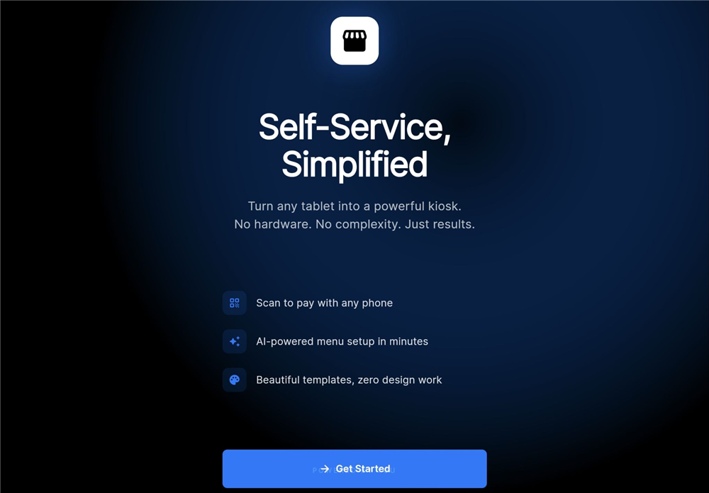<br><b>Welcome screen</b></td>
    <td align="center">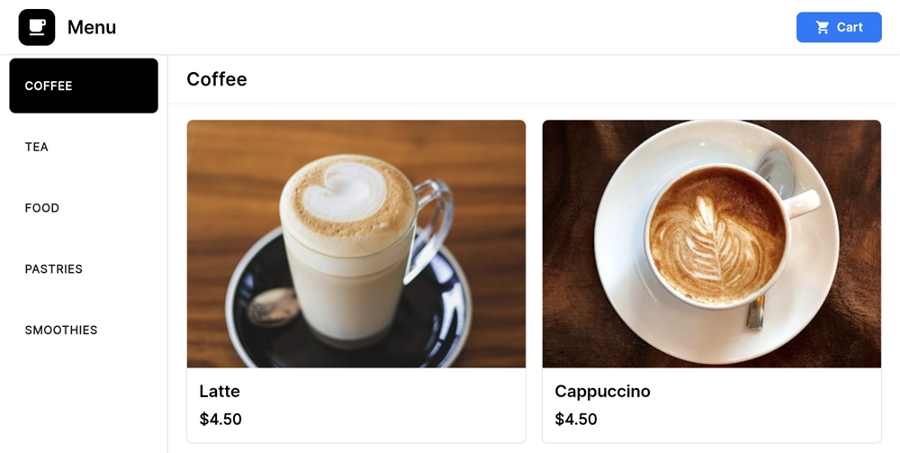<br><b>Menu with categories</b></td>
  </tr>
  <tr>
    <td align="center">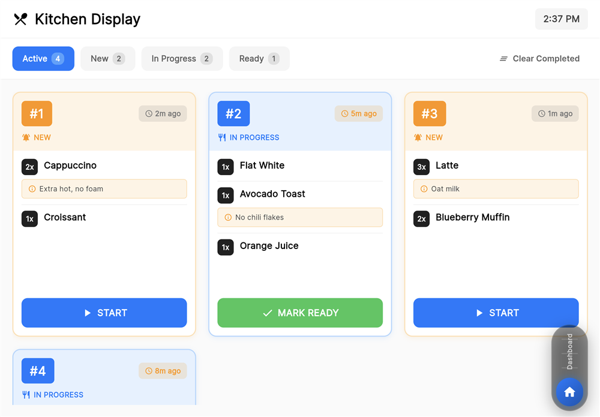<br><b>QR payment (simulated)</b></td>
    <td align="center">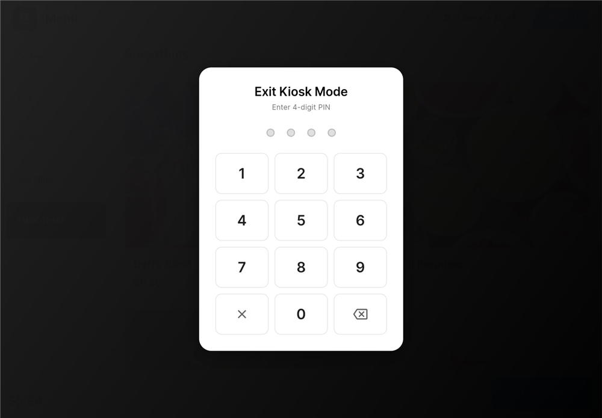<br><b>Staff PIN to exit kiosk mode</b></td>
  </tr>
</table>

### Merchant back office

<table>
  <tr>
    <td align="center">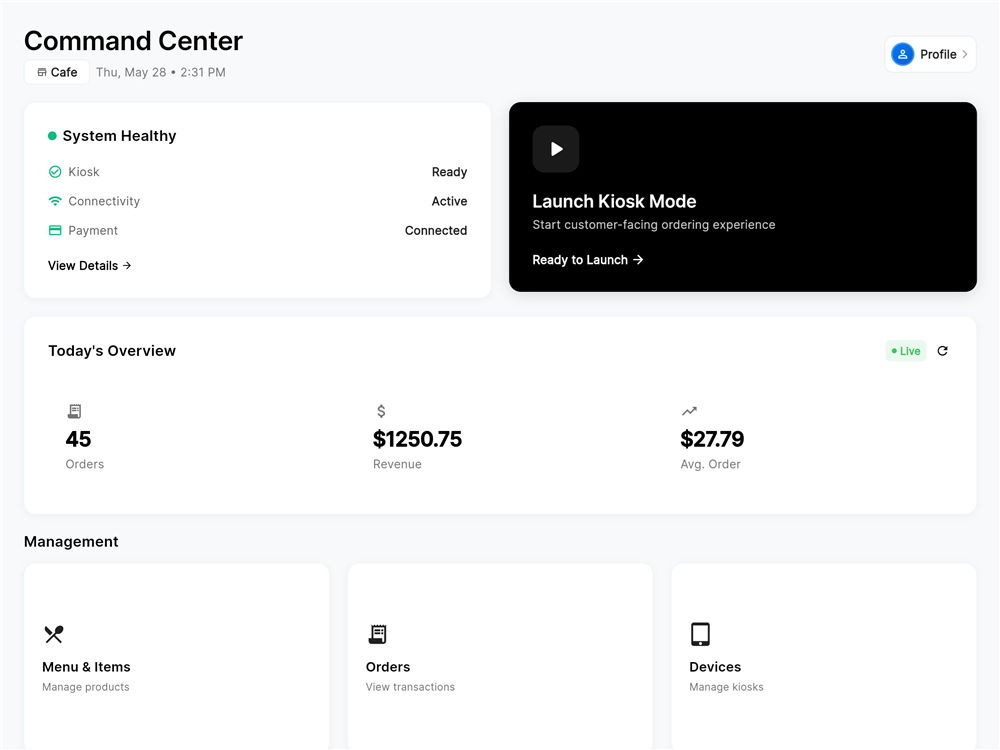<br><b>Merchant dashboard</b></td>
    <td align="center">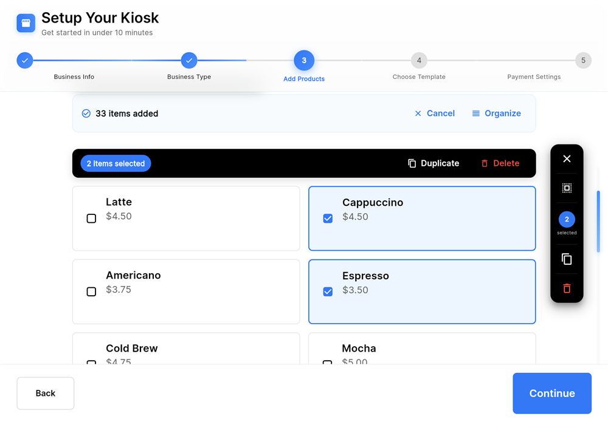<br><b>5-step onboarding wizard</b></td>
  </tr>
  <tr>
    <td align="center">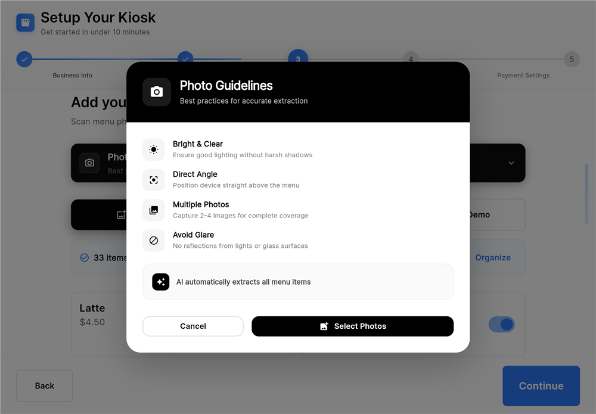<br><b>Optional AI menu scanning (needs your own API key)</b></td>
    <td align="center">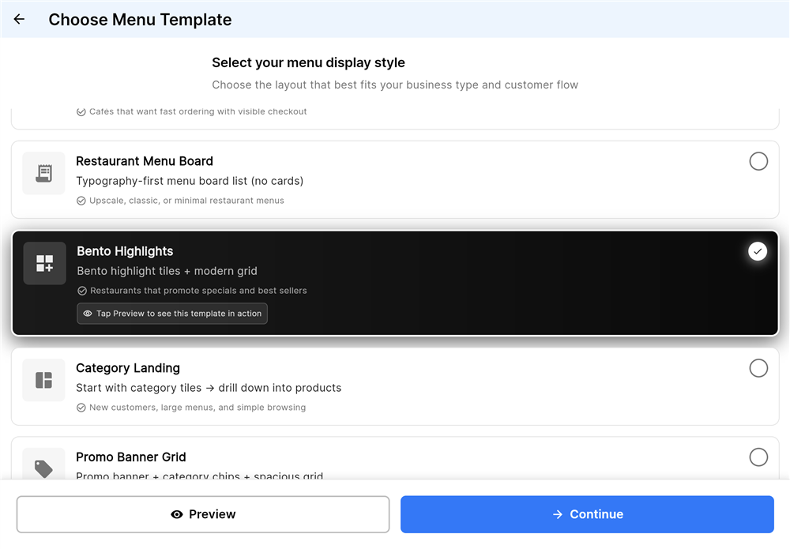<br><b>Menu template gallery</b></td>
  </tr>
  <tr>
    <td align="center">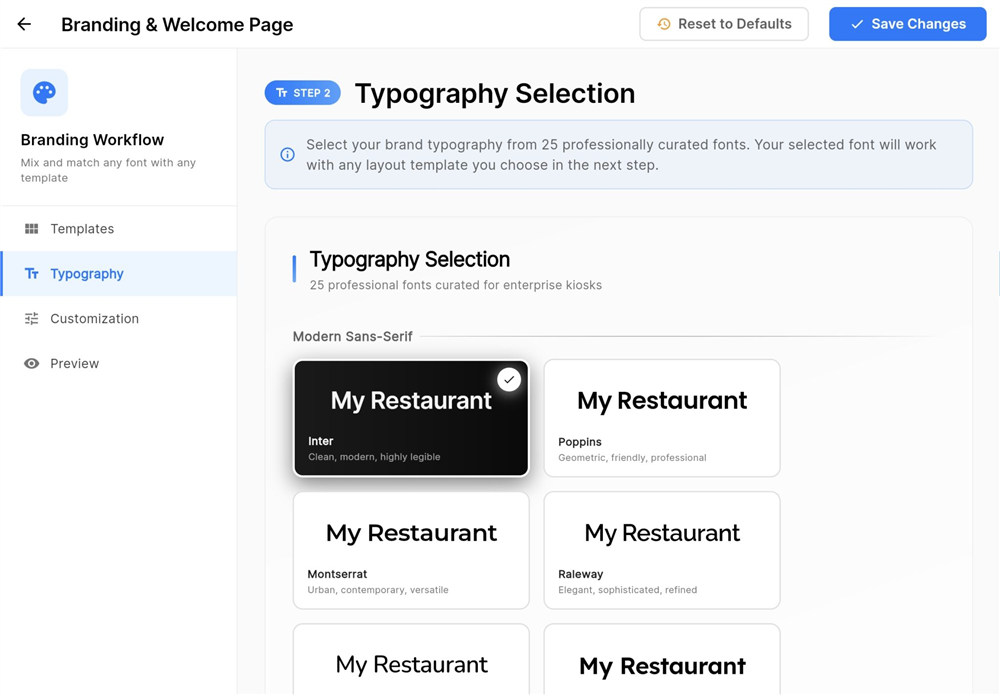<br><b>Branding: 25-font typography selector</b></td>
    <td align="center">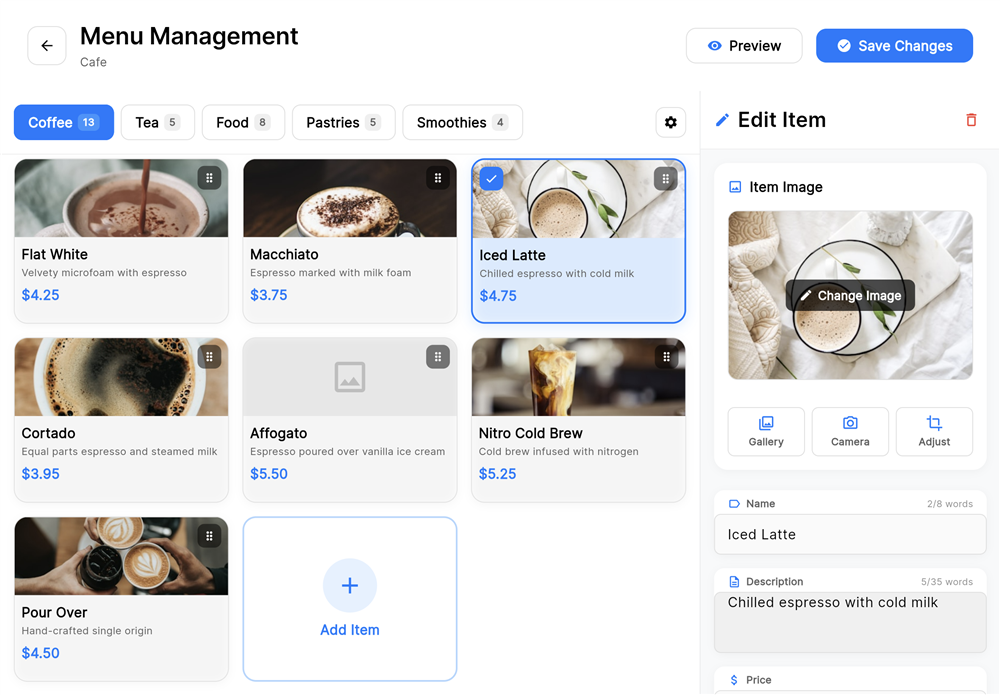<br><b>Menu management</b></td>
  </tr>
  <tr>
  <tr>
    <td align="center">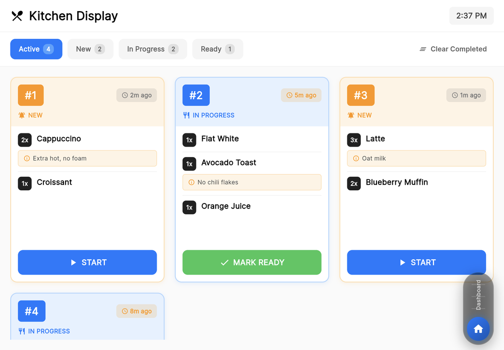<br><b>Kitchen display</b></td>
    <td align="center">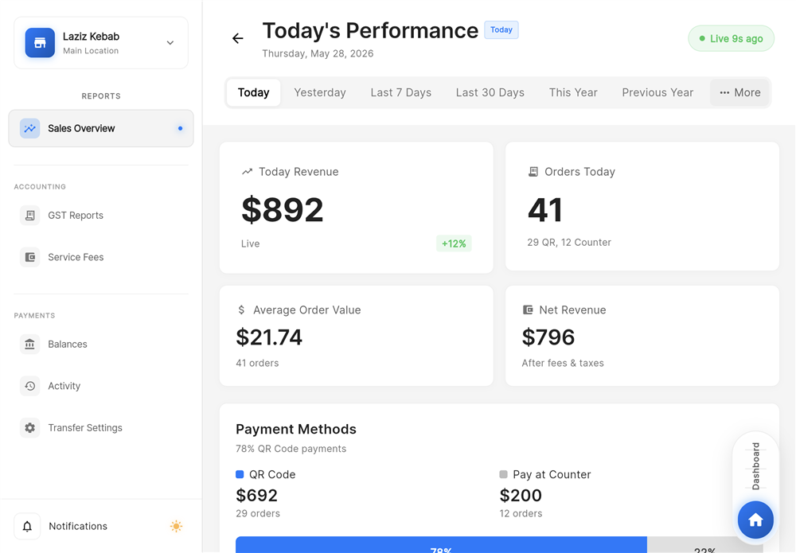<br><b>Sales analytics</b></td>
  </tr>
  <tr>
    <td align="center">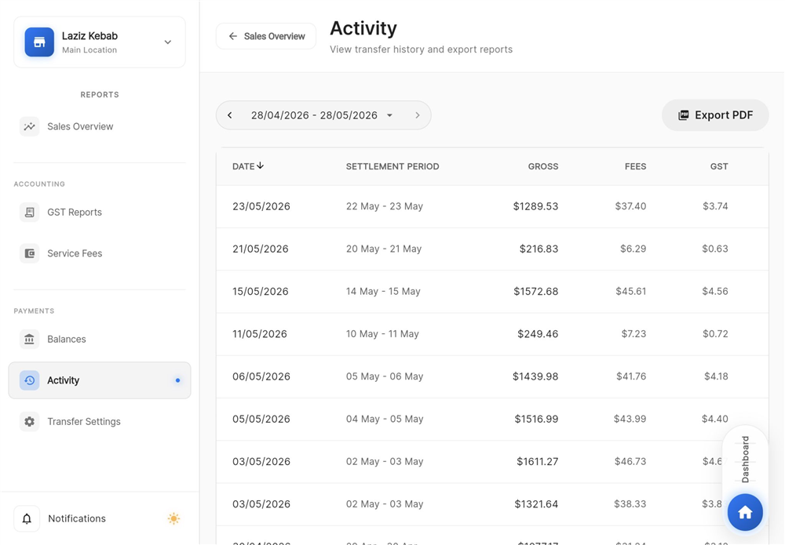<br><b>Payouts activity &amp; PDF export</b></td>
  </tr>
</table>

## What works

Verified end-to-end in Chrome:

| Area | Status |
|---|---|
| Kiosk flow: welcome → dine-in/takeaway → categorised menu | Working |
| Item customisation (size, milk, notes, quantity) with live pricing | Working |
| Cart + checkout with service fee (2.5% + $0.30) | Working |
| **Pay at Counter** → confirmation → auto-return to menu | Working |
| **QR payment**: kiosk shows QR → phone checkout page → kiosk detects payment by polling | Working (simulated) |
| Dashboard, branding editor, menu management, onboarding wizard | Screens load; state is in-memory only |
| Kitchen display, analytics/sales charts, payouts | UI only, driven by **sample data** (not by real orders) |
| Optional AI menu scanning (Gemini) | Needs your own API key; off by default; not tested for this release |

## Tech stack

- **Flutter / Dart** (Flutter 3.32, Dart 3.8), landscape-first Material UI
- **Riverpod** (state), **go_router** (navigation)
- **freezed / json_serializable** immutable models (generated files are committed)
- **qr_flutter**, **fl_chart**, **google_fonts**
- **shelf / shelf_router**: small local Dart server hosting the web build and a mock payment API
- Plain HTML/JS simulated phone checkout page (`web/checkout.html`)

## Structure

```
lib/
├── core/             # theme, colours, spacing, reusable widgets
├── domain/           # entities (Product, Order, Merchant...)
├── data/             # mock data sources & repositories
├── features/payouts  # payouts module
├── presentation/     # kiosk, payments, onboarding, branding, menu_management, analytics, kitchen
└── server/           # payment_server.dart - local mock backend (in-memory)
web/checkout.html     # simulated "customer phone" payment page
```

**QR payment flow:** kiosk `POST /api/orders` → shows QR for `/checkout.html?order=...` → phone page calls `POST /api/payments/process` → server marks the session `paid` → kiosk polls `GET /api/payment-sessions/:id` every 2 s and shows success.

## Getting started

Prerequisites: [Flutter SDK](https://docs.flutter.dev/get-started/install) 3.32+ and Chrome.

```bash
flutter pub get
flutter build web --release                  # 1. build the app
dart run lib/server/payment_server.dart      # 2. serve app + mock payment API on :8080
```

- Customer kiosk: <http://localhost:8080/#/kiosk>
- Merchant dashboard: <http://localhost:8080/#/dashboard>

To try the QR flow on one machine: press *Scan QR to Pay*, then open
`http://localhost:8080/checkout.html?order=<order id from server log>&amount=<total>` in another tab and pay.
For a real phone, use your computer's LAN address instead of `localhost`.

*Pay at Counter* also works with plain `flutter run -d chrome`; only the QR flow needs the server.

### Optional: AI menu scanning

```bash
flutter run -d chrome --dart-define=GEMINI_API_KEY=your_key
```

Never commit API keys. Without the flag the feature is disabled.

### Tests

```bash
flutter test
```

Covers only the payouts `Money` model and CSV export so far.

## limitations

- Everything is **in-memory** (menu edits, orders, payment sessions reset on restart); no database.
- Payments are simulated; the mock server has no authentication, webhook signing or HTTPS.
- Kitchen display, analytics and payouts use generated sample data.
- Some dependencies in `pubspec.yaml` (hive, dio/retrofit, mobile_scanner, wakelock_plus) are declared but not used yet.
- Test coverage is minimal; `flutter analyze` reports lint-level infos/warnings but no errors.
- Only web has been verified; iOS/Android builds are required.


